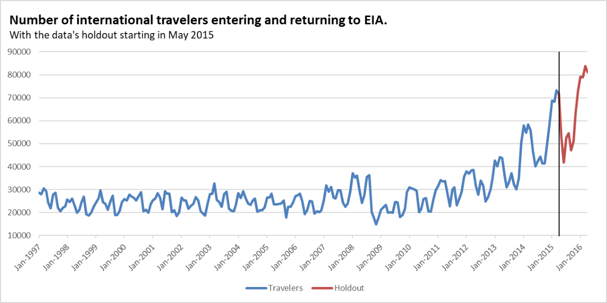
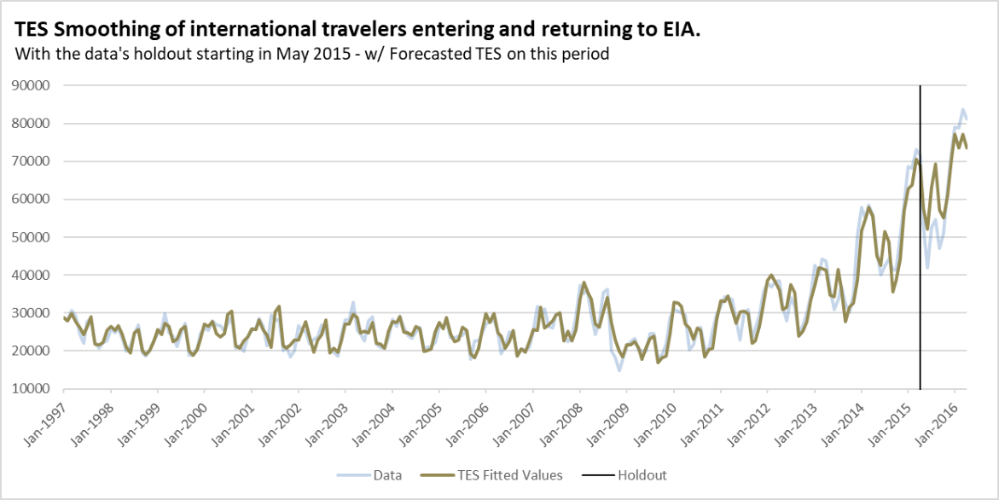
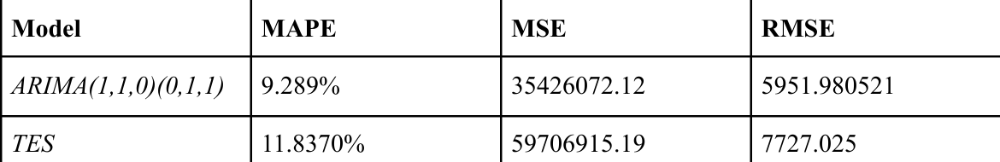

# Edmonton International Airport Passenger Forecasting

## Project Overview

This project analyzes historical international passenger
volumes at Edmonton International Airport (EIA) to
identify a suitable model for forecasting future
passenger demand.

## Tools & Technologies

- Microsoft Excel
- ForecastX
- Time Series Analysis
- Statistical Modelling
- Data Visualization

## Methodology

- Analyzed historical passenger volumes to identify
  trends and seasonal patterns.
- Established a holdout period beginning in May 2015.
- Applied Triple Exponential Smoothing (Holt-Winters).
- Developed and evaluated seasonal ARIMA models.
- Applied detrending techniques to address non-stationarity.
- Evaluated models using MAPE, MSE, RMSE, AIC, BIC,
  and Ljung-Box statistical diagnostics.

## Data Visualization

### Historical Passenger Volumes

Historical international passenger data demonstrates
recurring seasonal fluctuations and an underlying
growth trend.

### Triple Exponential Smoothing

Triple Exponential Smoothing was applied to capture
the underlying trend and seasonal components of
passenger demand.

### Forecast Accuracy Comparison

Seasonal ARIMA outperformed Triple Exponential
Smoothing across MAPE, MSE, and RMSE, supporting
further investigation of ARIMA-based forecasting models.

## Model Performance

| Model | MAPE | MSE |
|---|---:|---:|
| Triple Exponential Smoothing | 11.84% | 59,706,915 |
| Seasonal ARIMA (1,1,0)(0,1,1) | 9.29% | 35,426,072 |
| Detrended ARIMA (1,0,0)(1,0,0) | 9.75% | 12,466,668 |

## Key Findings

- Historical passenger volumes demonstrated strong
  seasonality and exponential growth.
- Seasonal ARIMA outperformed Triple Exponential
  Smoothing across multiple forecast accuracy metrics.
- Detrending produced a model with lower reported
  MSE while maintaining a competitive MAPE.

## Final Recommendation

The analysis recommended the detrended seasonal
ARIMA (1,0,0)(1,0,0) model for forecasting future
international passenger volumes.

## Business Applications

- Demand forecasting
- Workforce planning
- Capacity management
- Operational budgeting
- Resource allocation

## Limitations

Differences in sample periods, data transformations,
and measurement scales should be considered when
comparing model performance.

## Project Files

- [Forecasting Report](Edmonton_Airport_Forecasting_Report.pdf)
- [Excel Forecasting Model](Edmonton_Airport_Forecasting_Model.xlsx)

## Academic Context

MGTSC 405 – Forecasting

Alberta School of Business | University of Alberta

Winter 2026

